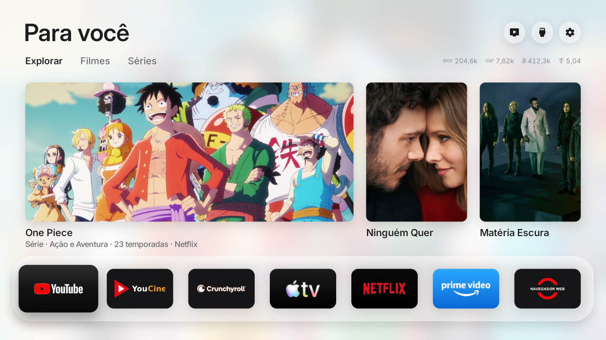
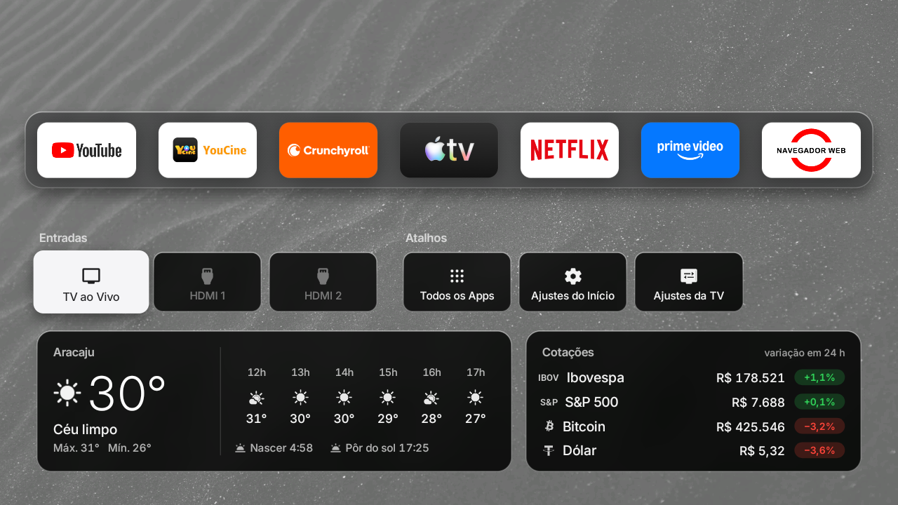

# 📺 Porto-TV-Rack

> Um inicializador (launcher) ultra leve, rápido e limpo para Smart TVs Android / Google TV (como as televisões TCL), totalmente livre de anúncios e configurado para o Brasil.

<p align="center">
  
  <br><br>
  
</p>

---

> ⚠️ **Aviso Importante sobre Aplicativos de Streaming:**
> O **Porto-TV-Rack** funciona exclusivamente como a tela inicial (launcher) da sua Smart TV. Por questões técnicas e legais, ele **não contém nem instala automaticamente** os aplicativos de terceiros. 
> Serviços como **YouCine**, **Netflix**, **Prime Video**, **Crunchyroll**, etc., precisam já estar instalados na televisão (seja via Google Play Store, aplicativo Downloader ou pendrive) para que os atalhos da prateleira consigam abri-los.

---

## ✨ O que este projeto tem de especial?

* **Prateleira com 7 Apps:** Acesso direto a YouTube, YouCine, Crunchyroll, Apple TV, Netflix, Prime Video e Navegador Web.
* **Ícone do YouCine Exclusivo:** Desenvolvido sob medida com fundo transparente em alta definição.
* **Clima em Tempo Real:** Pré-configurado para **Aracaju - SE** (latitude: -10.9472, longitude: -37.0731).
* **Painel Financeiro:** Cotações ao vivo de **IBOV**, **S&P 500**, **Bitcoin (BTC)** e **Dólar (USD)**.
* **Zero Lerdeza:** Abre no mesmo segundo em que a TV liga, sem travar a interface.

---

## 🧭 Guia Passo a Passo de Instalação

Siga as etapas na ordem abaixo. Não precisa ter conhecimento avançado: basta ler com atenção e copiar os comandos.

---

### Etapa 1: Preparar a sua Televisão 📺

O seu computador precisa de autorização para se comunicar com a televisão pela rede Wi-Fi.

1. Ligue a TV e pegue o controle remoto.
2. Abra as **Configurações** (ícone de engrenagem) > **Sistema** > **Sobre**.
3. Desça até a opção **Número da Versão** (ou **Build**) e aperte o botão central do controle **7 vezes seguidas**.
   * *Aparecerá um aviso na tela dizendo: "Você agora é um desenvolvedor!".*
4. Volte uma tela, entre em **Opções do desenvolvedor** e ative a opção **Depuração USB**.
5. Descubra o número IP da televisão:
   * Vá em **Configurações** > **Rede e Internet** > clique na sua rede Wi-Fi conectada.
   * Anote os números que aparecem em **Endereço IP** (exemplo: `192.168.3.10`).

---

### Etapa 2: Baixar o Aplicativo 📥

1. No seu computador, vá na seção **[Releases](../../releases)** deste repositório.
2. Na versão **v1.0**, clique no arquivo **`FreeMyTV.apk`** para fazer o download.
3. Deixe o arquivo guardado na sua pasta tradicional de **Downloads**.

---

### Etapa 3: Instalar o ADB no seu Computador 💻

O **ADB** é uma ferramenta do Google que funciona como uma ponte direta pela rede Wi-Fi. Escolha abaixo a seção correspondente ao sistema que você utiliza:

#### 🪟 Se você usa Windows
1. Baixe o pacote oficial portátil do Google clicando aqui: **[Platform-Tools para Windows](https://dl.google.com/android/repository/platform-tools-latest-windows.zip)**.
2. Abra a sua pasta de Downloads, clique com o botão direito no arquivo baixado e escolha **Extrair Tudo**.
3. Mova o arquivo **`FreeMyTV.apk`** que você baixou na Etapa 2 para **DENTRO** da pasta extraída chamada `platform-tools`.
4. Dentro dessa pasta `platform-tools`, clique na barra de endereço (onde fica o caminho da pasta no topo da janela), digite `cmd` e aperte **Enter**.
   * *Uma janela preta do Prompt de Comando se abrirá já apontada para o local correto.*

---

#### 🐧 Se você usa Linux (Zorin OS, Ubuntu, Debian, Mint)
1. Abra o seu **Terminal** (atalho: `Ctrl + Alt + T`).
2. Instale o ADB rodando o comando:
   ```bash
   sudo apt update && sudo apt install -y adb
   ```
3. Pelo terminal, entre na sua pasta de Downloads onde o arquivo foi salvo:
   ```bash
   cd ~/Downloads
   ```

---

#### 🍏 Se você usa Mac (macOS)
1. Abra o **Terminal** (pressione `Command + Barra de Espaço`, digite `Terminal` e aperte **Enter**).
2. Se você usa o gerenciador Homebrew, instale rodando:
   ```bash
   brew install android-platform-tools
   ```
   *(Caso não use o Homebrew, baixe o **[Platform-Tools para Mac](https://dl.google.com/android/repository/platform-tools-latest-darwin.zip)**, descompacte a pasta, mova o arquivo `FreeMyTV.apk` para dentro dela e abra o terminal dentro dessa pasta).*
3. Entre na pasta onde está o arquivo baixado:
   ```bash
   cd ~/Downloads
   ```

---

### Etapa 4: Conectar e Instalar na TV 🚀

Com a janela de terminal/prompt aberta no mesmo diretório em que está o arquivo `FreeMyTV.apk`, execute os comandos abaixo na ordem:

> **Atenção:** Nos comandos abaixo, substitua `192.168.3.10` pelo número IP real da sua TV que você anotou na Etapa 1.

#### 1. Conectar o computador à TV
* **No Linux ou Mac:**
  ```bash
  adb connect 192.168.3.10:5555
  ```
* **No Windows (CMD):**
  ```cmd
  adb connect 192.168.3.10:5555
  ```
* **Olhe para a tela da TV agora:** surgirá um aviso perguntando *"Permitir depuração USB?"*. Marque a opção *"Sempre permitir deste computador"* e confirme em **OK** com o controle remoto.

#### 2. Instalar o launcher
* **No Linux ou Mac:**
  ```bash
  adb install -g FreeMyTV.apk
  ```
* **No Windows (CMD):**
  ```cmd
  adb install -g FreeMyTV.apk
  ```
*(Aguarde alguns segundos até que surja a confirmação **Success**).*

#### 3. Conceder permissão de inicialização em segundo plano (essencial para TVs TCL)
* **No Linux ou Mac:**
  ```bash
  adb shell "appops set io.freemytv AUTO_START allow || appops set io.freemytv APP_AUTO_START allow"
  ```
* **No Windows (CMD):**
  ```cmd
  adb shell "appops set io.freemytv AUTO_START allow || appops set io.freemytv APP_AUTO_START allow"
  ```

#### 4. Iniciar o launcher na tela
* **No Linux, Mac ou Windows:**
  ```bash
  adb shell am start -n io.freemytv/.HomeActivity
  ```

---

## 🛠️ Para Desenvolvedores: Compilação Manual do Código

Caso queira inspecionar ou personalizar o código-fonte antes de gerar o APK no Linux:

```bash
# 1. Instalar os pacotes necessários
sudo apt-get update
sudo apt-get install -y git openjdk-17-jdk adb aapt zipalign python3-pil

# 2. Clonar este repositório
git clone [https://github.com/andremporto/Porto-TV-Rack.git](https://github.com/andremporto/Porto-TV-Rack.git)
cd Porto-TV-Rack

# 3. Compilar o arquivo APK
chmod +x build.sh
./build.sh

# 4. Enviar diretamente para a TV conectada
adb connect IP_DA_SUA_TV:5555
adb install -r -g FreeMyTV.apk
adb shell am start -n io.freemytv/.HomeActivity
```

---

## 📌 Créditos
Baseado no projeto open-source original **Free My TV**, com prateleira reestruturada, criação do asset em alta resolução com canal alfa para o YouCine e localização de clima e mercado financeiro para o Brasil.
