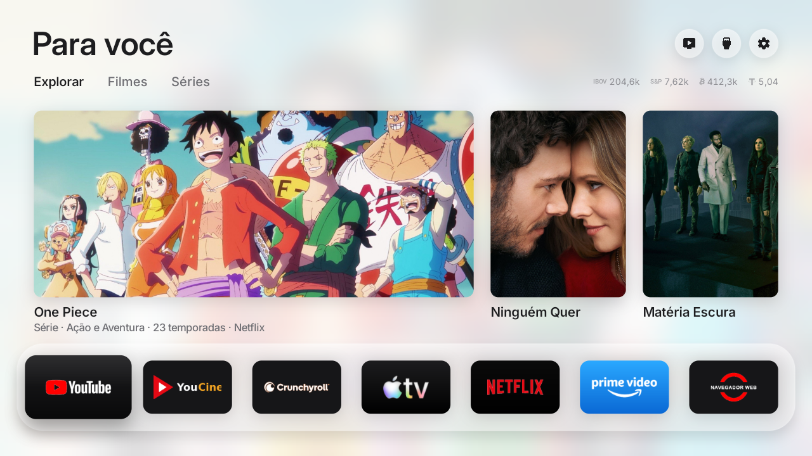
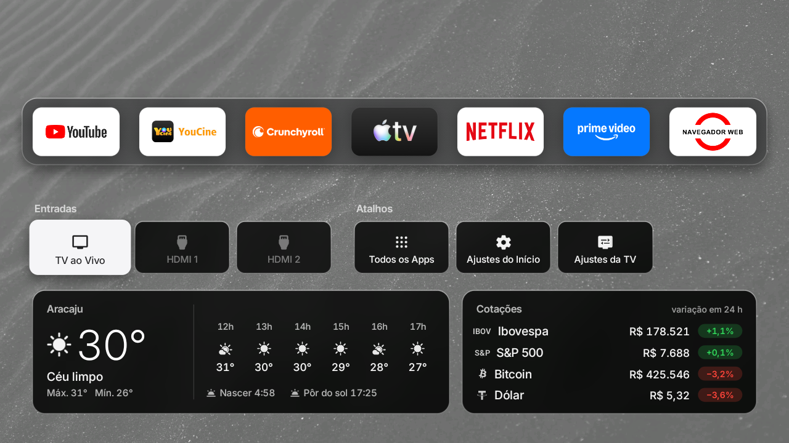
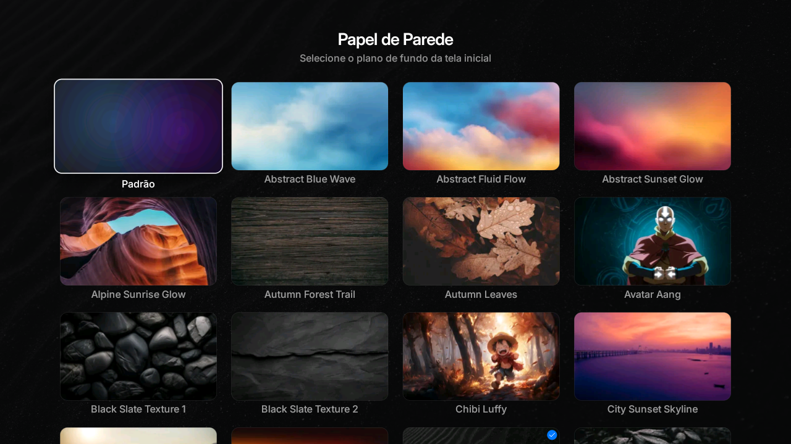

# 📺 GlassTV

> Um inicializador (launcher) ultra leve, rápido e moderno para Smart TVs Android / Google TV (como as televisões TCL), totalmente livre de anúncios e configurado para o Brasil.

> 📺 **Compatibilidade de Dispositivos:**
> * ✅ **100% Compatível:** Qualquer Smart TV, TV Stick ou TV Box com **Google TV ou Android TV** (TCL, Sony Bravia, Philips, Panasonic, Philco, Hisense, Chromecast com Google TV, Xiaomi Mi Box/Stick, Amazon Fire TV Stick, etc.).
> * ❌ **Incompatível nativamente:** Smart TVs **Samsung (Tizen OS)**, **LG (webOS)** e **Roku TV** — esses sistemas não suportam arquivos APK Android diretamente. Para utilizá-lo nessas TVs, basta conectar um Chromecast ou TV Stick em uma entrada HDMI.

<p align="center">
  
  <br><br>
  
  <br><br>
  
</p>

---

> ⚠️ **Aviso Importante sobre Aplicativos de Streaming:**
> O **GlassTV** funciona exclusivamente como a tela inicial (launcher) da sua Smart TV. Por questões técnicas e legais, ele **não contém nem instala automaticamente** os aplicativos de terceiros. 
> Serviços como **YouCine**, **Netflix**, **Prime Video**, **Crunchyroll**, etc., precisam já estar instalados na televisão (seja via Google Play Store, aplicativo Downloader ou pendrive) para que os atalhos da prateleira consigam abri-los.

---

## 📦 Escolha a sua Versão

O GlassTV está disponível em duas versões prontas para atender ao seu perfil de uso:

| Recurso | ⚡ **Glass TV Light** (Recomendada) | 📺 **Glass TV Completa** |
| :--- | :---: | :---: |
| **Arquivo APK** | [**`GlassTV-Light.apk`**](GlassTV-Light.apk) | [**`GlassTV.apk`**](GlassTV.apk) |
| **Design / Layout** | **Apple tvOS em 3 Blocos** (Top Bar, Shelf 16:9, Entradas/Atalhos) | Layout Clássico com Feed Horizontal |
| **Feed do YouTube** | ❌ Desativado (Zero consumo em background) | ✅ Integrado via OAuth 2.0 Device Flow |
| **Consumo de Memória (RAM)** | **Extremamente Baixo (< 6 MB Java Heap)** | Baixo (< 15 MB) |
| **Painel Financeiro** | **6 Ativos** (IBOV, S&P 500, BTC, ETH, SOL, Dólar) | 4 Ativos (IBOV, S&P 500, BTC, Dólar) |
| **Detecção de Pen Drive (USB)** | ✅ Automática e dinâmica na barra de Entradas | ❌ |
| **Papéis de Parede Nativos** | ✅ 53 Wallpapers HD 1080p | ✅ 53 Wallpapers HD 1080p |
| **Ideal para** | TVs de entrada (1 GB a 2 GB RAM), rapidez extrema | Quem deseja navegar no YouTube pela Home |

---

## ✨ O que este projeto tem de especial?

* **Design Apple tvOS em 3 Blocos (Versão Light):**
  * **Header Superior:** Identificador nítido "Glass TV Light" e botões circulares de ação rápida (TV Aberta, Entradas, Papéis de Parede, Ajustes).
  * **Bloco 1 (Informações):** Cards de Meteorologia completa e Cotações Financeiras (6 ativos) em vidro escuro translúcido com cantos contínuos (*squircles*).
  * **Bloco 2 (Prateleira de Destaque):** 7 Apps Essenciais em proporção widescreen 16:9 (`196 x 110.25dp`) sobre bandeja cápsula de vidro escuro com sombra ambiente suave.
  * **Bloco 3 (Entradas & Atalhos):** Entradas (TV ao Vivo, HDMI 1, HDMI 2, USB dinâmico) e atalhos essenciais alinhados às margens.
* **Detecção Dinâmica de Pen Drive / USB:** Ícone inteligente no bloco de entradas que surge automaticamente ao plugar um pen drive ou HD externo, abrindo o gerenciador de arquivos.
* **53 Papéis de Parede Nativos em HD:** Galeria integrada expandida para 53 papéis de parede em alta definição 1080p e miniaturas de 320x180 para navegação super fluida.
* **Otimização Extrema de Memória RAM:** Motor de renderização configurado em `RGB_565` (reduz o peso dos bitmaps pela metade) e reciclagem ativa de memória, mantendo o consumo de Java Heap abaixo de 6 MB.
* **Zero Lerdeza:** Inicialização instantânea ao ligar a TV, sem anúncios e sem engasgos em TVs de entrada.
* **Versão Completa com Feed do YouTube:** Mantida no repositório (`GlassTV.apk`) para quem ainda deseja autenticação OAuth 2.0 e feed ao vivo de recomendações.

---

## 🧭 Guia Passo a Passo de Instalação

Siga as etapas na ordem abaixo. Não precisa ter conhecimento avançado: basta ler com atenção e copiar os comandos.

---

### Etapa 1: Preparar a sua Televisão 📺

O seu computador precisa de autorização para se comunicar com a televisão pela rede Wi-Fi.

1. Ligue a TV e pegue o controle remoto.
2. Abra as **Configurações** (ícone de engrenagem) > **Sistema** > **Sobre**.
3. Desça até a opção **Número da Versão** (ou **Build**) e aperte o botão central do controle **7 vezes seguidas**.
   * *Aparecerá um aviso na tela dizendo: "Você agora é um desenvolvedor!".*
4. Volte uma tela, entre em **Opções do desenvolvedor** e ative a opção **Depuração USB**.
5. Descubra o número IP da televisão:
   * Vá em **Configurações** > **Rede e Internet** > clique na sua rede Wi-Fi conectada.
   * Anote os números que aparecem em **Endereço IP** (exemplo: `192.168.3.10`).

---

### Etapa 2: Baixar o Aplicativo 📥

1. No seu computador, vá na seção **[Releases](../../releases)** deste repositório (ou baixe diretamente pelos links da tabela acima).
2. Baixe o APK desejado:
   * **Recomendado:** **`GlassTV-Light.apk`** (Versão Light, moderna e super veloz).
   * **Alternativa:** **`GlassTV.apk`** (Versão Completa com feed de YouTube).
3. Deixe o arquivo guardado na sua pasta tradicional de **Downloads**.

> 💡 **Dica: Prefere instalar direto pela TV sem usar computador?**  
> 1. Na loja de aplicativos da sua TV, instale o app gratuito **Downloader by AFTVnews**.  
> 2. No campo de navegação do Downloader, digite o link direto da versão Light:  
>    `https://github.com/andremporto/GlassTV/releases/latest/download/GlassTV-Light.apk`  
>    *(Ou digite o link terminando em `GlassTV.apk` para a versão completa).*  
> 3. Conclua o download e clique em **Install** diretamente pela tela da televisão.  
> *(Você também pode simplesmente copiar o APK para um pendrive e abri-lo na TV com qualquer gerenciador de arquivos como o X-plore).*

---

### Etapa 3: Instalar o ADB no seu Computador 💻

O **ADB** é uma ferramenta do Google que funciona como uma ponte direta pela rede Wi-Fi. Escolha abaixo a seção correspondente ao sistema que você utiliza:

#### 🪟 Se você usa Windows
1. Baixe o pacote oficial portátil do Google clicando aqui: **[Platform-Tools para Windows](https://dl.google.com/android/repository/platform-tools-latest-windows.zip)**.
2. Abra a sua pasta de Downloads, clique com o botão direito no arquivo baixado e escolha **Extrair Tudo**.
3. Mova o arquivo **`GlassTV.apk`** que você baixou na Etapa 2 para **DENTRO** da pasta extraída chamada `platform-tools`.
4. Dentro dessa pasta `platform-tools`, clique na barra de endereço (onde fica o caminho da pasta no topo da janela), digite `cmd` e aperte **Enter**.
   * *Uma janela preta do Prompt de Comando se abrirá já apontada para o local correto.*

---

#### 🐧 Se você usa Linux (Zorin OS, Ubuntu, Debian, Mint)
1. Abra o seu **Terminal** (atalho: `Ctrl + Alt + T`).
2. Instale o ADB rodando o comando:
   ```bash
   sudo apt update && sudo apt install -y adb
   ```
3. Pelo terminal, entre na sua pasta de Downloads onde o arquivo foi salvo:
   ```bash
   cd ~/Downloads
   ```

---

#### 🍏 Se você usa Mac (macOS)
1. Abra o **Terminal** (pressione `Command + Barra de Espaço`, digite `Terminal` e aperte **Enter**).
2. Se você usa o gerenciador Homebrew, instale rodando:
   ```bash
   brew install android-platform-tools
   ```
   *(Caso não use o Homebrew, baixe o **[Platform-Tools para Mac](https://dl.google.com/android/repository/platform-tools-latest-darwin.zip)**, descompacte a pasta, mova o arquivo `GlassTV.apk` para dentro dela e abra o terminal dentro dessa pasta).*
3. Entre na pasta onde está o arquivo baixado:
   ```bash
   cd ~/Downloads
   ```

---

### Etapa 4: Conectar e Instalar na TV 🚀

Com a janela de terminal/prompt aberta no mesmo diretório em que está o arquivo `GlassTV-Light.apk` (ou `GlassTV.apk`), execute os comandos abaixo na ordem:

> **Atenção:** Nos comandos abaixo, substitua `192.168.3.10` pelo número IP real da sua TV que você anotou na Etapa 1.

#### 1. Conectar o computador à TV
* **No Linux ou Mac:**
  ```bash
  adb connect 192.168.3.10:5555
  ```
* **No Windows (CMD):**
  ```cmd
  adb connect 192.168.3.10:5555
  ```
* **Olhe para a tela da TV agora:** surgirá um aviso perguntando *"Permitir depuração USB?"*. Marque a opção *"Sempre permitir deste computador"* e confirme em **OK** com o controle remoto.

#### 2. Instalar o launcher
* **No Linux ou Mac:**
  ```bash
  adb install -g GlassTV-Light.apk
  # (ou 'adb install -g GlassTV.apk' se tiver baixado a versão completa)
  ```
* **No Windows (CMD):**
  ```cmd
  adb install -g GlassTV-Light.apk
  REM (ou 'adb install -g GlassTV.apk' se tiver baixado a versão completa)
  ```
*(Aguarde alguns segundos até que surja a confirmação **Success**).*

#### 3. Conceder permissão de inicialização em segundo plano (essencial para TVs TCL)
* **No Linux ou Mac:**
  ```bash
  adb shell "appops set io.freemytv AUTO_START allow || appops set io.freemytv APP_AUTO_START allow"
  ```
* **No Windows (CMD):**
  ```cmd
  adb shell "appops set io.freemytv AUTO_START allow || appops set io.freemytv APP_AUTO_START allow"
  ```

#### 4. Iniciar o launcher na tela
* **No Linux, Mac ou Windows:**
  ```bash
  adb shell am start -n io.freemytv/.HomeActivity
  ```

#### 5. Definir como Tela Inicial Padrão ao apertar a tecla HOME do controle
Dependendo da marca da sua TV (especialmente em modelos Google TV como Sony, Philips, TCL ou Chromecast), o sistema tenta forçar o launcher de fábrica com anúncios. Para fazer a tecla **Home** do controle abrir diretamente o **GlassTV**:

* **Opção Recomendada (Via comando ADB no terminal/Prompt):**
  Desative temporariamente a tela cheia de anúncios do sistema original:
  * **Para Google TV (Chromecast, Sony, Philips, TCL mais recentes):**
    ```bash
    adb shell pm disable-user --user 0 com.google.android.apps.tv.launcherx
    ```
  * **Para Android TV Clássico:**
    ```bash
    adb shell pm disable-user --user 0 com.google.android.tvlauncher
    ```
  *(Caso queira reativar a qualquer momento a tela original de fábrica, basta executar: `adb shell pm enable com.google.android.apps.tv.launcherx`)*.

* **Opção Sem Computador (Via App da Play Store):**
  Instale o aplicativo gratuito **Button Mapper** na Play Store da sua TV, ative o serviço de acessibilidade do app e configure um toque simples no botão **Home** para iniciar o **GlassTV**.

---

## 🛠️ Para Desenvolvedores: Compilação Manual do Código

Caso queira inspecionar ou personalizar o código-fonte antes de gerar o APK no Linux:

```bash
# 1. Instalar os pacotes necessários
sudo apt-get update
sudo apt-get install -y git openjdk-17-jdk adb aapt zipalign python3-pil

# 2. Clonar este repositório
git clone https://github.com/andremporto/GlassTV.git
cd GlassTV

# 3. Compilar o arquivo APK
chmod +x build.sh
./build.sh

# 4. Enviar diretamente para a TV conectada
adb connect IP_DA_SUA_TV:5555
adb install -r -g GlassTV.apk
adb shell am start -n io.freemytv/.HomeActivity
```

---

## 📌 Créditos
Baseado no projeto open-source original **Free My TV**, evoluído para **GlassTV** com estética moderna glassmorphism, integração nativa com YouTube via OAuth 2.0, prateleira refinada, ícone translúcido do YouCine e localização de meteorologia e mercado financeiro para o Brasil.
